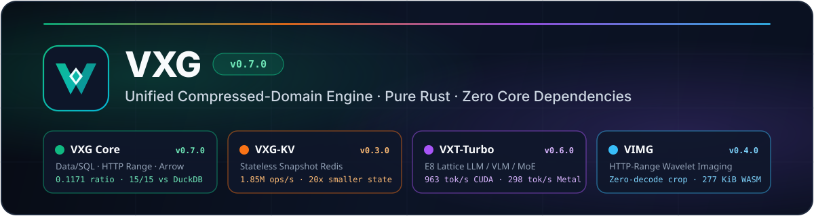

<p align="center">
  
</p>

<p align="center">
  <a href="https://github.com/meftunca/vxg/actions/workflows/ci.yml"></a>
  <a href="https://github.com/meftunca/vxg/actions/workflows/benchmarks.yml"></a>
  <a href="https://github.com/meftunca/vxg/releases"></a>
  <a href="https://meftunca.github.io/vxg/playground"></a>
  <a href="https://meftunca.github.io/vxg/vimg-playground"></a>
  <a href="LICENSE"></a>
</p>

<p align="center">
  <a href="https://meftunca.github.io/vxg/"><strong>Documentation</strong></a> ·
  <a href="https://meftunca.github.io/vxg/playground"><strong>SQL Playground</strong></a> ·
  <a href="https://meftunca.github.io/vxg/vimg-playground"><strong>Image Studio</strong></a> ·
  <a href="crates/vxg-kv/README.md"><strong>VXG-KV</strong></a> ·
  <a href="docs/CHIMERA_BENCHMARKS.md"><strong>Full Benchmarks</strong></a> ·
  <a href="CONTRIBUTING.md"><strong>Contributing</strong></a>
</p>

---

**VXG** is a pure-Rust, zero-core-dependency **compressed-domain computing ecosystem**. Instead of treating compression as a passive archival step you have to unpack before doing real work, every VXG format is engineered to **query, filter, slice, serve over HTTP/1.1 `Range`, and execute directly on compressed blocks**.

## The Four Pillars

<table>
  <tr>
    <td width="50%" valign="top">
      
      <strong>&nbsp; <a href="docs/guide/getting-started.md">VXG Core</a> <code>v0.7.0</code></strong><br/>
      <sub>&nbsp; Data Compression · SQL · Arrow · HTTP/1.1 Range</sub>
      <br clear="left"/><br/>
      Store raw NDJSON/CSV verbatim (100% byte-exact reversible), beat <code>Zstd+Dict-9</code> on the 6-dataset real geomean (<code>0.1171</code> vs <code>0.1181</code>), run SQL or filtered DuckDB/Polars <code>read_vxg()</code> over 40M+ rows (<strong>15/15 vs DuckDB 2.0</strong> in-cache), and query remote <code>http://</code> files via HTTP Range.<br/><br/>
      <a href="https://meftunca.github.io/vxg/playground">Live Playground</a> · <a href="packages/vxg-wasm/README.md"><code>@vxg/wasm</code></a> · <a href="https://github.com/meftunca/vxg/releases/tag/v0.7.0">Release</a>
    </td>
    <td width="50%" valign="top">
      
      <strong>&nbsp; <a href="crates/vxg-kv/README.md">VXG-KV</a> <code>v0.3.0</code></strong><br/>
      <sub>&nbsp; Stateless Snapshot Redis (RESP2/RESP3)</sub>
      <br clear="left"/><br/>
      Zero-dep <code>kqueue</code>/<code>epoll</code> Redis server backed by HTTP Range + sharded ETag CAS object storage. Beats <code>Redis 8.10.3</code> <strong>11/11</strong> (<code>1.67M–1.85M ops/s</code>, <code>1.93×</code> less CPU) with <code>20×</code> smaller snapshots, <code>7×</code> less cold RAM, <code>AUTH/HELLO 3</code>, <code>JSON.*</code>, <code>GEO*</code>, <code>BLPOP</code>, <code>XGROUP</code>, Time-Travel &amp; <code>VXG.SQL</code>.<br/><br/>
      <a href="crates/vxg-kv/README.md">Docs</a> · <a href="docs/KV.md">Architecture</a> · <a href="https://github.com/meftunca/vxg/releases/tag/vxg-kv-v0.3.0">Release</a>
    </td>
  </tr>
  <tr>
    <td width="50%" valign="top">
      
      <strong>&nbsp; <a href="crates/vxg-tensor/README.md">VXT-Turbo</a> <code>v0.6.0</code></strong><br/>
      <sub>&nbsp; E8 Lattice AI Model Codec · Metal &amp; CUDA</sub>
      <br clear="left"/><br/>
      Compressed-domain <code>E8</code> / <code>E8-HQ</code> Gosset lattice LLM/VLM/MoE codec beating <code>GGUF Q6_K</code> &amp; <code>Q8_0</code> at smaller footprints. Executes directly on GPU at <strong>963 tok/s</strong> (RTX 5090 CUDA Resident) and <strong>298 tok/s</strong> (Apple Metal), with Speculative Decoding &amp; OpenAI SSE server.<br/><br/>
      <a href="docs/TENSOR.md">Spec &amp; Benchmarks</a> · <a href="apps/vxt-studio/README.md">VXT Studio</a>
    </td>
    <td width="50%" valign="top">
      
      <strong>&nbsp; <a href="crates/vimg/README.md">VIMG</a> <code>v0.4.0</code></strong><br/>
      <sub>&nbsp; HTTP-Range Wavelet Image &amp; Animation Codec</sub>
      <br clear="left"/><br/>
      Zero-dep 8/10/12/16-bit HDR wavelet pyramid (<code>VIMG1</code>) &amp; animation container (<code>VIMA1</code>). <code>1.00 ms</code> UI Palette+RLE, zero-decode crop/downscale, <code>ProgressiveDecoder</code>, WebP Edge Proxy, and <code>277 KiB</code> <code>+simd128</code> WASM.<br/><br/>
      <a href="https://meftunca.github.io/vxg/vimg-playground">Image Studio</a> · <a href="packages/vimg-wasm/README.md"><code>@vimg/wasm</code></a> · <a href="https://github.com/meftunca/vxg/releases/tag/vimg-v0.4.0">Release</a>
    </td>
  </tr>
</table>

---

## Quick Start in 30 Seconds

```bash
# 1. VXG Core: compress NDJSON/CSV & run compressed-domain SQL (local or http:// Range!)
cargo run --release --bin vxg -- compress trips.ndjson trips.vxg --record-aligned -t auto -f
cargo run --release --bin vxg -- sql trips.vxg \
  "SELECT payment_type, COUNT(*), SUM(total_cents) GROUP BY payment_type ORDER BY SUM(total_cents) DESC"

# 2. VXG-KV: start stateless Redis server backed by local dir or HTTP CAS origin
cargo run --release -p vxg-kv -- server --port 6379 --dir ./kv-data --wal-shards 4
redis-cli -p 6379 JSON.SET user:1 '$' '{"plan":"pro","spend":120}'
redis-cli -p 6379 VXG.SQL "SELECT data.plan, COUNT(*), SUM(data.spend) GROUP BY data.plan"

# 3. VIMG: encode wavelet image & serve HTTP 206 partial crops / resizes
cargo run --release -p vimg -- encode photo.png photo.vimg -q 80 --aq
cargo run --release -p vimg -- serve ./images --port 8080

# 4. VXT-Turbo: pack GGUF/SafeTensors to E8 .vxt & serve OpenAI-compatible API
cargo run --release -p vxg-tensor -- pack model.gguf model.vxt --preset q6
```

---

## Headline Benchmarks (Reproducible, Honest Trade-Offs)

| Pillar | Benchmark | Result | Competitor Baseline |
| :--- | :--- | :---: | :--- |
| **VXG Core** | 6-dataset real public `64 KiB` geomean (`8T`) | **`0.1171`** (`15.35 GB/s` dec) | `Zstd+Dict-9 [32..256K]` `0.1181` · `LZ4` `0.2500` |
| **VXG Core** | Cumulative time-series (`covid-19` `64 KiB`) | **`0.0963`** (`PFOR-Delta`) | `Zstd-9` `0.1415` · whole `zstd -19 --long` `0.1066` |
| **VXG Core** | In-cache SQL (`200k–300k` rows, `1T` & `8T`) | **15 / 15 wins** (`0.03–0.23 ms` `8T`) | `DuckDB 2.0 + Parquet` (`0.81–6.86 ms`) |
| **VXG-KV** | `redis-benchmark` (`c=16, P=16`, 11 cmds) | **11 / 11 wins** (`1.67M–1.85M ops/s`, `0.55s` CPU) | `Redis 8.10.3` (`311k–1.56M ops/s`, `1.06s` CPU) |
| **VXG-KV** | 100k JSON Snapshot / Cold RSS / `GROUP BY` | **`271 KiB`** / **`2.86 MiB`** / **`7.88 ms`** | `Redis 8.10.3` `5,458 KiB` / `20.12 MiB` / `211 ms` |
| **VXT-Turbo** | `Qwen3.5-9B` GPU Inference (`E8-HQ`) | **`963 tok/s`** CUDA · **`298 tok/s`** Metal (0.8B) | Beats `GGUF Q6_K` (`-0.43 GB`) & `Q8_0` (`-0.89 GB`) |
| **VIMG** | 1080p Lossless UI / Lossless Photo | **`1.00 ms`** (`0.20 bpp`) / **`-38.6%` vs PNG** | `PNG` `1.38 ms` · `WebP Lossless` (`60×` slower enc) |

> **Honest Scope — Where Competitors Win:**
> - **Individual unstructured files (`64 KiB`):** `Zstd+Dict-9 [32..256K]` leads individual nested JSON (`gharchive`: `0.1072` vs `0.1181`), free-text logs (`apache-access.clf`, `macos-install.log`), non-repeating source (`0.1872` vs `0.1917`), prose (`shakespeare`), and raw camera BMP (`0.7363` vs `0.7985`). `LZ4 (a1)` leads raw `GB/s` on unstructured inputs (`4.95 / 20.52` vs `1.52 / 15.35 GB/s`).
> - **Cold NVMe SSD (`F_NOCACHE`) multi-GB analytics:** `DuckDB + Parquet` wins `10 / 10` true cold-disk queries (`12–63 ms` vs `103–644 ms`) because Parquet stores contiguous `122,880`-row column chunks vs VXG's self-contained PAX blocks.
> - **Redis Lua/Functions & Geo-replicated active-active:** `VXG-KV` targets stateless snapshot/object-storage workloads and does not ship Lua scripting or Redis Cluster slot resharding.

---

## Verified Benchmark Tables (CI Drift-Checked from `reports/`)

Every table below is deterministically generated from [`reports/`](reports/) via [`scripts/render_tables.py`](scripts/render_tables.py) and drift-checked on every CI push. Click to expand any suite (full commentary in [`docs/CHIMERA_BENCHMARKS.md`](docs/CHIMERA_BENCHMARKS.md) & [`docs/BENCHMARKS.md`](docs/BENCHMARKS.md)):

<details open>
<summary><strong>1. Real-World Public, Time-Series &amp; Source Corpora (<code>64 KiB</code> blocks vs Zstd+Dict-9 &amp; LZ4)</strong></summary>

<br/>

<!-- BEGIN GENERATED TABLE: real-public-summary-8t -->
| Real Public / OS Corpus (`8T`, `64 KiB` blocks) | Size | VXG Ratio | LZ4 (`a1`) | Zstd-9 | Zstd+Dict-9 `[32..256K]` | `zstd -19 --long` *(whole)* | VXG Enc / Dec (`GB/s`) | LZ4 (`a1`) Enc / Dec | Zstd-1 Enc / Dec | Zstd+D3 Enc / Dec |
| :--- | :---: | :---: | :---: | :---: | :---: | :---: | :---: | :---: | :---: | :---: |
| **`nyc-taxi-2024-01.ndjson`** *(NYC TLC, 200k trips)* | 52.3 MB | **0.0593** | 0.1899 | 0.0823 | 0.0784 | 0.0554 | **8.84** / **38.59** | 6.36 / 21.98 | 4.46 / 11.51 | 3.49 / 8.62 |
| **`nyc-taxi-2024-01.csv`** *(NYC TLC, 300k trips)* | 23.0 MB | **0.1829** | 0.4241 | 0.2194 | 0.2141 | 0.1617 | 3.22 / 14.66 | **3.36** / **21.08** | 2.45 / 8.71 | 1.74 / 4.51 |
| **`gharchive-2025-01-15.ndjson`** *(12k nested GitHub API)* | 50.3 MB | 0.1181 | 0.2256 | 0.1414 | **0.1072** | 0.0633 | 0.95 / 15.31 | **6.13** / **23.29** | 4.60 / 11.13 | 2.49 / 11.56 |
| **`apache-access.clf`** *(Elastic real HTTP CLF)* | 2.4 MB | 0.0974 | 0.1730 | 0.1062 | **0.0896** | 0.0535 | 0.75 / 12.75 | **5.80** / **13.44** | 4.60 / 8.46 | 2.75 / 9.89 |
| **`macos-install.log`** *(OS free-text multi-line log)* | 34.2 MB | 0.0548 | 0.1249 | 0.0770 | **0.0452** | 0.0278 | 2.34 / 18.04 | 10.10 / **45.50** | **10.30** / 23.11 | 3.58 / 16.52 |
| **`pg100-shakespeare.txt`** *(Gutenberg English prose)* | 5.6 MB | 0.3780 | 0.6223 | 0.3918 | **0.3729** | 0.3000 | 0.26 / 6.57 | **1.91** / **11.32** | 1.84 / 5.19 | 0.92 / 4.05 |
| **`kodak-truecolor-16.bmp`** *(16 real camera photos)* | 18.9 MB | 0.7985 | 0.8732 | 0.7494 | **0.7363** | 0.5656 | 0.39 / 13.73 | **4.90** / **25.62** | 2.94 / 6.67 | 0.63 / 4.78 |
| **Text & Structured Geomean (6)** | — | **0.1171** | 0.2500 | 0.1419 | 0.1181 | 0.0795 | 1.52 / 15.35 | **4.95** / **20.52** | 4.04 / 10.21 | 2.27 / 8.17 |
<!-- END GENERATED TABLE: real-public-summary-8t -->

<br/>

<!-- BEGIN GENERATED TABLE: covid-and-src -->
| Cumulative Time-Series & Non-Repeating Source (`64 KiB` blocks) | Size | VXG Ratio | LZ4 (`a1`) | Zstd-1 | Zstd-9 | Zstd+Dict-9 `[32..256K]` | `zstd -19 --long` *(whole)* | `1T` VXG Enc / Dec (`GB/s`) | `8T` VXG Enc / Dec (`GB/s`) | `8T` LZ4 (`a1`) Enc / Dec |
| :--- | :---: | :---: | :---: | :---: | :---: | :---: | :---: | :---: | :---: | :---: |
| **`time-series-19-covid-combined.csv`** *(datasets/covid-19 cumulative time series)* | 8.6 MB | **0.0963** | 0.3254 | 0.1459 | 0.1415 | 0.1495 | 0.1066 | 0.49 / 1.96 | 2.08 / 11.05 | **5.06** / **19.27** |
| **`us_confirmed_33m.csv`** *(datasets/covid-19 US county cumulative prefix)* | 35.2 MB | **0.0456** | 0.2363 | 0.1032 | 0.0897 | 0.0938 | 0.0619 | 0.76 / 3.22 | 4.38 / 24.66 | **8.32** / **24.68** |
| **`vxg-src-nonrepeating.rs`** *(All unique VXG src/*.rs files, 0% repeat)* | 2.9 MB | 0.1917 | 0.3333 | 0.2322 | 0.1939 | **0.1872** | 0.1342 | 0.08 / 1.30 | 0.38 / 7.26 | **4.21** / **13.04** |
<!-- END GENERATED TABLE: covid-and-src -->

</details>

<details>
<summary><strong>2. In-Cache Analytical SQL (<code>200k–300k</code> Rows, <code>1T / 8T</code>): VXG vs DuckDB 2.0 + Parquet</strong></summary>

<br/>

<!-- BEGIN GENERATED TABLE: duckdb-in-cache -->
| Corpus & Query (`1T / 8T` latency in `ms`, lower is faster) | `VXG -l 3` (`64K` std) | `VXG -l 3 --record-aligned` | DuckDB `Parquet-Snappy` *(prep)* | DuckDB `Parquet-Snappy` *(RG=16k)* | DuckDB `Parquet-Zstd` *(prep)* | DuckDB Raw |
| :--- | :---: | :---: | :---: | :---: | :---: | :---: |
| **`nyc-taxi-2024-01.ndjson`** *(52.3 MB, 200k rows)* | 3.10 MB (`5.8 ms` `-l 3`, YES) | **2.86 MB** (`24.5 ms` `-l 3`, YES) | 3.94 MB (`81.8 ms` ETL, NO) | 4.17 MB (`76.0 ms`, NO) | 2.96 MB (`89.2 ms` ETL, NO) | `52.33 MB` (YES) |
| ↳ `COUNT(*) WHERE pay=1 & tip>=1000 & dist>=500` | 2.54 / 0.52 | **0.54** / **0.12** | 1.42 / 1.21 | 2.04 / 1.05 | 2.01 / 1.37 | 84.80 / 55.27 |
| ↳ `SUM/MIN/MAX(total_cents) [all 200k rows]` | 1.33 / 0.35 | **0.16** / **0.04** | 1.07 / 0.84 | 1.33 / 0.81 | 1.36 / 1.03 | 78.42 / 54.16 |
| ↳ `SUM/MIN/MAX(fare_cents) WHERE payment_type=2` | 1.75 / 0.46 | **0.29** / **0.11** | 1.25 / 0.89 | 1.47 / 0.83 | 1.51 / 1.08 | 83.97 / 55.55 |
| ↳ `GROUP BY payment_type: COUNT(*), SUM(total)` | 2.20 / 0.50 | **0.54** / **0.10** | 1.31 / 0.93 | 1.58 / 0.87 | 1.59 / 1.17 | 81.00 / 55.74 |
| ↳ `ORDER BY total_cents DESC LIMIT 10` | 1.63 / 0.81 | **0.45** / **0.19** | 2.77 / 2.10 | 2.53 / 1.68 | 4.85 / 3.32 | 89.02 / 58.79 |
| ↳ `SELECT 4 cols WHERE tip_cents >= 2500` | 2.17 / 0.87 | **1.12** / **0.25** | 3.06 / 3.16 | 3.48 / 3.66 | 5.19 / 5.29 | 94.40 / 59.62 |
| **`nyc-taxi-2024-01.csv`** *(23.0 MB, 300k rows)* | 4.21 MB (`8.1 ms` `-l 3`, YES) | **4.19 MB** (`19.9 ms` `-l 3`, YES) | 5.86 MB (`88.8 ms` ETL, NO) | 6.19 MB (`84.8 ms`, NO) | 4.39 MB (`96.1 ms` ETL, NO) | `23.00 MB` (YES) |
| ↳ `COUNT(*) WHERE pay=1 & tip>=1000 & dist>=500` | 0.94 / 0.19 | **0.83** / **0.14** | 1.83 / 1.22 | 2.84 / 1.24 | 2.86 / 1.52 | 78.66 / 51.13 |
| ↳ `SUM/MIN/MAX(total_cents) [all 300k rows]` | 0.40 / 0.13 | **0.33** / **0.06** | 1.35 / 0.90 | 1.77 / 0.92 | 1.79 / 1.11 | 76.68 / 49.13 |
| ↳ `SUM/MIN/MAX(fare_cents) WHERE payment_type=2` | 0.58 / 0.20 | **0.50** / **0.16** | 1.63 / 1.04 | 1.99 / 1.11 | 2.05 / 1.23 | 77.52 / 50.86 |
| ↳ `GROUP BY payment_type: COUNT(*), SUM(total)` | 1.07 / 0.33 | **0.91** / **0.26** | 1.62 / 1.00 | 2.11 / 1.02 | 2.07 / 1.20 | 80.92 / 51.94 |
| **`ndjson_varied.ndjson`** *(56.5 MB, 300k rows)* | 5.17 MB (`9.8 ms` `-l 3`, YES) | **4.70 MB** (`32.8 ms` `-l 3`, YES) | 9.70 MB (`107.4 ms` ETL, NO) | 9.72 MB (`101.0 ms`, NO) | 5.56 MB (`119.3 ms` ETL, NO) | `56.50 MB` (YES) |
| ↳ `COUNT(*) WHERE fraud & status=500 & lat>=150` | 2.73 / 0.51 | **0.90** / **0.15** | 1.09 / 0.83 | 1.64 / 1.06 | 1.42 / 0.99 | 99.18 / 61.06 |
| ↳ `SUM/MIN/MAX(bytes) [all 300k rows]` | 1.16 / 0.39 | **0.13** / **0.03** | 2.29 / 1.23 | 2.49 / 1.11 | 3.58 / 1.73 | 91.37 / 58.16 |
| ↳ `GROUP BY service: COUNT(*), SUM(bytes)` | 2.72 / 0.58 | **0.86** / **0.18** | 2.77 / 1.61 | 3.12 / 1.27 | 4.00 / 2.17 | 103.08 / 62.57 |
| ↳ `ORDER BY latency_ms DESC LIMIT 10` | 1.53 / 0.63 | **0.42** / **0.14** | 3.44 / 2.10 | 2.87 / 1.75 | 4.36 / 2.46 | 98.83 / 62.00 |
| ↳ `SELECT 3 cols WHERE fraud & 500 & lat>=150` | 2.80 / 0.82 | **0.96** / **0.20** | 6.82 / 6.86 | 4.64 / 4.67 | 8.87 / 9.00 | 108.23 / 64.17 |
<!-- END GENERATED TABLE: duckdb-in-cache -->

</details>

<details>
<summary><strong>3. Multi-GB Scale (<code>10M–40M</code> NYC Taxi Rows): Warm OS Cache vs Cold NVMe (<code>F_NOCACHE</code>)</strong></summary>

<br/>

<!-- BEGIN GENERATED TABLE: duckdb-scale-40m-csv -->
| `nyc-taxi-2024-40m.csv` (`40M` rows, `3.06 GB` raw; **Warm OS Cache** `1T / 8T` in `ms`) | `VXG -l 3` (`64K` std) | `VXG -l 3 --record-aligned` | DuckDB `Parquet-Snappy` *(prep)* | DuckDB `Parquet-Snappy` *(RG=16k)* | DuckDB `Parquet-Zstd` *(prep)* |
| :--- | :---: | :---: | :---: | :---: | :---: |
| **Archive Size & `8T` Ingest (`-l 3`) / ETL** | 552.9 MB (`5.21 s` `-l 3`, YES) | **550.4 MB** (`1.69 s` `-l 3`, YES) | 773.1 MB (`4.32 s`, NO) | 818.9 MB (`4.74 s`, NO) | 579.4 MB (`3.72 s`, NO) |
| `COUNT(*) WHERE pay=1 & tip>=1000 & dist>=500` | 162.72 / 26.05 | **150.67** / **25.88** | 159.14 / 36.79 | 282.92 / 105.64 | 275.13 / 60.13 |
| `SUM/MIN/MAX(total_cents) [full scan]` | 91.34 / 15.25 | **82.42** / **12.64** | 156.03 / 28.03 | 218.78 / 62.24 | 210.90 / 34.48 |
| `SUM/MIN/MAX(fare_cents) WHERE payment_type=2` | 114.70 / 17.03 | **107.33** / **16.06** | 138.55 / 31.43 | 204.45 / 70.70 | 195.58 / 36.11 |
| `GROUP BY payment_type: COUNT(*), SUM(total_cents)` | 180.78 / 34.35 | **162.75** / **27.79** | 177.54 / 35.50 | 262.69 / 84.15 | 241.67 / 38.14 |
| `ORDER BY total_cents DESC LIMIT 10` | 88.79 / 20.98 | 63.08 / **11.07** | **30.05** / 18.03 | 91.18 / 78.75 | 46.00 / 21.97 |
<!-- END GENERATED TABLE: duckdb-scale-40m-csv -->

<br/>

<!-- BEGIN GENERATED TABLE: duckdb-scale-40m-csv-cold -->
| `nyc-taxi-2024-40m.csv` (`40M` rows; **Cold NVMe Cache** `8T` in `ms`, `F_NOCACHE` evicted) | `VXG -l 3` (`64K` std, cold) | `VXG -l 3 --record-aligned` (cold) | DuckDB `Parquet-Snappy` *(cold)* | DuckDB `Parquet-Snappy` *(RG=16k, cold)* | DuckDB `Parquet-Zstd` *(cold)* |
| :--- | :---: | :---: | :---: | :---: | :---: |
| `COUNT(*) WHERE pay=1 & tip>=1000 & dist>=500` | 407.15 | 382.38 | 60.21 | 128.25 | **58.70** |
| `SUM/MIN/MAX(total_cents) [full scan]` | 386.27 | 569.23 | **32.44** | 148.02 | 42.21 |
| `SUM/MIN/MAX(fare_cents) WHERE payment_type=2` | 571.57 | 370.81 | **40.93** | 112.54 | 42.36 |
| `GROUP BY payment_type: COUNT(*), SUM(total_cents)` | 410.40 | 582.47 | **62.92** | 193.06 | 63.24 |
| `ORDER BY total_cents DESC LIMIT 10` | 529.15 | 643.57 | 30.23 | 101.47 | **27.02** |
<!-- END GENERATED TABLE: duckdb-scale-40m-csv-cold -->

<br/>

<!-- BEGIN GENERATED TABLE: duckdb-scale-10m-ndjson -->
| `nyc-taxi-2024-10m.ndjson` (`10M` rows, `2.62 GB` raw; **Warm OS Cache** `1T / 8T` in `ms`) | `VXG -l 3` (`64K` std) | `VXG -l 3 --record-aligned` | DuckDB `Parquet-Snappy` *(prep)* | DuckDB `Parquet-Snappy` *(RG=16k)* | DuckDB `Parquet-Zstd` *(prep)* |
| :--- | :---: | :---: | :---: | :---: | :---: |
| **Archive Size & `8T` Ingest (`-l 3`) / ETL** | 152.6 MB (`3.24 s` `-l 3`, YES) | **140.8 MB** (`0.67 s` `-l 3`, YES) | 193.3 MB (`0.96 s`, NO) | 203.4 MB (`1.21 s`, NO) | 144.6 MB (`0.96 s`, NO) |
| `COUNT(*) WHERE pay=1 & tip>=1000 & dist>=500` | 126.06 / 20.36 | **29.79** / **3.91** | 41.03 / 13.64 | 68.89 / 28.93 | 70.19 / 13.48 |
| `SUM/MIN/MAX(total_cents) [full scan]` | 70.13 / 13.98 | **11.75** / **2.30** | 38.35 / 15.43 | 54.11 / 21.73 | 53.58 / 10.81 |
| `SUM/MIN/MAX(fare_cents) WHERE payment_type=2` | 129.90 / 15.79 | **19.05** / **3.14** | 36.62 / 8.02 | 52.38 / 18.91 | 52.40 / 10.08 |
| `GROUP BY payment_type: COUNT(*), SUM(total_cents)` | 111.12 / 19.15 | **32.58** / **5.91** | 43.92 / 10.62 | 64.45 / 23.85 | 59.72 / 11.56 |
| `ORDER BY total_cents DESC LIMIT 10` | 84.78 / 38.73 | **9.58** / **1.58** | 16.10 / 9.50 | 24.29 / 27.98 | 27.29 / 14.11 |
<!-- END GENERATED TABLE: duckdb-scale-10m-ndjson -->

<br/>

<!-- BEGIN GENERATED TABLE: duckdb-scale-10m-ndjson-cold -->
| `nyc-taxi-2024-10m.ndjson` (`10M` rows; **Cold NVMe Cache** `8T` in `ms`, `F_NOCACHE` evicted) | `VXG -l 3` (`64K` std, cold) | `VXG -l 3 --record-aligned` (cold) | DuckDB `Parquet-Snappy` *(cold)* | DuckDB `Parquet-Snappy` *(RG=16k, cold)* | DuckDB `Parquet-Zstd` *(cold)* |
| :--- | :---: | :---: | :---: | :---: | :---: |
| `COUNT(*) WHERE pay=1 & tip>=1000 & dist>=500` | 144.43 | 103.21 | **16.12** | 35.22 | 25.91 |
| `SUM/MIN/MAX(total_cents) [full scan]` | 133.06 | 103.92 | 19.92 | 20.31 | **13.40** |
| `SUM/MIN/MAX(fare_cents) WHERE payment_type=2` | 126.63 | 140.85 | **12.21** | 52.65 | 16.17 |
| `GROUP BY payment_type: COUNT(*), SUM(total_cents)` | 146.90 | 146.56 | 31.84 | 38.57 | **15.16** |
| `ORDER BY total_cents DESC LIMIT 10` | 170.46 | 146.93 | 52.59 | 23.37 | **16.86** |
<!-- END GENERATED TABLE: duckdb-scale-10m-ndjson-cold -->

</details>

---

## Cross-Language FFI, Arrow / DuckDB & WebAssembly

VXG ships a zero-dependency C99 ABI ([`include/vxg.h`](include/vxg.h)), Apache Arrow C Data / C Stream export (`vxg_arrow_query_stream`), and zero-WASI WebAssembly packages (`@vxg/wasm`, `@vimg/wasm`). Ready-to-run examples live in [`examples/ffi/`](examples/ffi/) and full reference docs in [`docs/FFI.md`](docs/FFI.md):

| Language / Runtime | Integration | Example |
| :--- | :--- | :--- |
| **Rust** | `vxg`, `vxg-kv`, `vimg`, `vxg-tensor` workspace crates | [`docs/guide/api-and-ffi.md`](docs/guide/api-and-ffi.md) |
| **Python + DuckDB / Polars** | Zero-copy `ctypes` & filtered `read_vxg()` Arrow stream | [`examples/ffi/duckdb_read_vxg.py`](examples/ffi/duckdb_read_vxg.py) |
| **C / C++** | Static or dynamic `libvxg` + `include/vxg.h` | [`examples/ffi/c_example.c`](examples/ffi/c_example.c) |
| **Go / C# (.NET 8+) / Node & Bun** | `cgo`, `Span<byte>` P/Invoke, `Uint8Array` FFI | [`examples/ffi/`](examples/ffi/) |
| **Browser / Cloudflare Workers** | `@vxg/wasm` & `@vimg/wasm` (`+simd128`, zero WASI) | [`packages/vxg-wasm`](packages/vxg-wasm) · [`packages/vimg-wasm`](packages/vimg-wasm) |

---

## Repository Map

```text
vxg/
├── src/                    # Core VXG v5 codec, SQL engine, Arrow IPC, HTTP/1.1 Range, C ABI
├── crates/
│   ├── vxg-kv/             # Stateless snapshot Redis (RESP2/RESP3, kqueue/epoll, JSON/Geo, XGROUP)
│   ├── vxg-tensor/         # VXT-Turbo E8 lattice LLM/VLM/MoE codec + Metal/CUDA inference
│   └── vimg/               # VIMG1/VIMA1 HTTP-Range wavelet image & animation codec
├── packages/
│   ├── vxg-wasm/           # @vxg/wasm (TypeScript + WASM SQL & codec)
│   └── vimg-wasm/          # @vimg/wasm (TypeScript + +simd128 wavelet imaging)
├── apps/vxt-studio/        # Companion desktop UI for VXT-Turbo local LLM inference
├── assets/                 # Official SVG brand banner & module logos
├── docs/                   # VitePress documentation site + live WASM playgrounds
├── examples/ffi/           # C, Python/DuckDB, Go, C#, Bun/Node, WASM examples
├── reports/ & scripts/     # Reproducible benchmark artifacts & CI drift checker
└── tests/                  # Frozen v1–v5 wire vectors, fuzzing & E2E suites
```

---

## Community, Security & License

- **Contribute:** Read [`CONTRIBUTING.md`](CONTRIBUTING.md) — PRs for new hardware benchmarks, FFI wrappers, custom `ObjectStore` adapters (S3/R2/GCS), and docs are very welcome!
- **Issues & Benchmarks:** Use our structured [Bug Report](https://github.com/meftunca/vxg/issues/new?template=bug_report.yml), [Feature Request](https://github.com/meftunca/vxg/issues/new?template=feature_request.yml), or [Benchmark Report](https://github.com/meftunca/vxg/issues/new?template=benchmark_report.yml) templates.
- **Security:** See [`SECURITY.md`](SECURITY.md) and [`docs/SAFETY.md`](docs/SAFETY.md).
- **License:** Dual-licensed / [MIT License](LICENSE).
