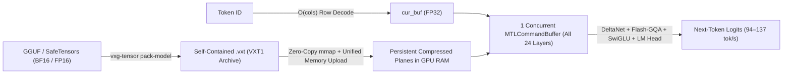

# `vxg-tensor` (`.vxt`) — Compressed-Domain AI Model Codec & Fused Apple Metal LLM Engine

`crates/vxg-tensor` extends VXG from structured telemetry and columnar analytics into **neural network weight compression (`.vxt` `VXT1`) and zero-decompression GPU/SIMD LLM inference**.

Instead of inflating compressed weights back to `BF16`/`FP16` in RAM or VRAM, `vxg-tensor` uploads the **compressed `.vxt` planes directly into Apple Silicon Unified Memory** and executes the entire autoregressive LLM forward pass (`RMSNorm`, `Gated-DeltaNet` recurrent state updates, `Flash-Decoding` `Gated-GQA`, `SwiGLU`, and `248,320`-vocab `LM Head`) inside **one single concurrent `MTLCommandBuffer` per token** — with **`0` external runtime crate dependencies**.

<TensorBenchmarkChart />

---

## Key Highlights (`Qwen3.5-2B` End-to-End on Apple M2 Max)

- **100% Bit-Exact Lossless (`VXT-Lossless-BF16`)**: Shrinks `Qwen3.5-2B-BF16.gguf` from **`3600.80 MiB` -> `2556.80 MiB` (`1.41x` smaller, `11.35 bpw`)** with **`0.000000 nats` KL divergence**, `1.000000` cosine similarity, and `100.0%` Top-1 logit identity — verified bit-for-bit against raw `BF16` at **`41.8–49.6 tok/s`** directly on compressed bit-planes.
- **Superior 4-Bit Quality & Size vs `GGUF Q4_0` (`VXT-CB4+Outlier`)**: Compresses the full 2B model (including its `248,320`-token BPE vocabulary) under `1 GiB` (**`993.59 MiB`, `3.62x` smaller**) — **`27.2 MiB` smaller than `GGUF Q4_0` (`1020.83 MiB`)** while achieving **`1.76x` lower KL divergence (`0.0304` vs `0.0533 nats`)**, higher weight SQNR (`20.82 dB` vs `19.76 dB`), `93.8%` vs `87.5%` Top-1 teacher-forced agreement, and **`93.6–105.0 tok/s`** fused Metal GPU generation.
- **Sub-800 MiB & Sub-670 MiB Ultra-Compact Modes (`CB3+Outlier` & `WHT2+Outlier`)**:
  - `VXT-CB3+Outlier` (`3.38 bpw`): **`772.40 MiB` (`4.66x` smaller)** with **`0.1117 nats` KL**, **`100%` Top-1 match** on the 16-step evaluation rollout, and **`80.4 tok/s`** decode.
  - `VXT-WHT2+Outlier` (`2.31 bpw` Walsh-Hadamard 2-bit FFN/Attn + `3.38 bpw` recurrent gates): **`645.96 MiB` (`5.57x` smaller)** with **`93.8%` (`15/16`) teacher-forced Top-1 match** and **`114.2 tok/s`** GPU decode (`140.9 tok/s` prefill).
- **Single-Matrix Fused `GEMV` Bandwidth**: Reaches **`710–720 GB/s` effective `BF16` bandwidth** on `VXT-CB4+Outlier` / `VXT-WHT2+Outlier` and **`995.8 GB/s`** on `Q4_0` (`2.03x–2.85x` faster than raw `BF16` `GEMV` on `248,320 x 2048` `token_embd.weight`).

---

## Architecture & Single-Command-Buffer Metal Pipeline



### Why 1 `MTLCommandBuffer` Matters on Apple Silicon

Launching individual `GEMV` command buffers per projection (`4` dispatches $\times 24$ layers $+ 1 = 97$ commits/token) incurs ~`450 us` of XNU/Metal scheduler latency per commit (~`45 ms/token`), capping decode throughput around `15 tok/s` even when actual GPU math takes `< 5 ms`.

`vxg-tensor` eliminates this bottleneck via `native/metal_llm.mm` and `native/shaders/vxt_llm_ops.metal`:
1. **Concurrent Metal Encoder (`MTLDispatchTypeConcurrent`)**: Independent projections sharing the same normalized input (`wqkv` + `attn_gate` + `ssm_alpha` + `ssm_beta`, `wq` + `wk` + `wv`, and `ffn_gate` + `ffn_up`) execute **concurrently across all GPU cores** without serial stalls, synchronized strictly by explicit `MTLBarrierScopeBuffers` barriers.
2. **All-GPU Hybrid `qwen35` Operators**:
   - `vxt_rms_norm` & fused residual `vxt_add_rms_norm` (`256`-thread simdgroup reduction).
   - `vxt_deltanet_conv` + register-resident `vxt_deltanet_heads` (`dk = 128` unrolled `r0..r3` single-load/single-store state matrix update in `FP32`).
   - `vxt_gqa_prep` (fused QKV bias + per-head QK `RMSNorm` + partial/full NeoX `RoPE` + KV-cache write) + `vxt_gqa_attn` (8-simdgroup online Flash-Decoding softmax + sigmoid Q-gate).
   - `vxt_fwht32_vec` (5-step `simd_shuffle_xor` butterfly Walsh-Hadamard rotation in pure SIMD registers, `0` threadgroup shared memory).

---

## Mathematical Codec Modes (`VXT1`)

Every `.vxt` archive (`MAGIC = b"VXT1"`, version `1`) stores model hyperparameters (`model.config`), Byte-Level BPE vocabulary & merge tables (`tokenizer.*`), and 64-byte-aligned compressed tensor sections protected by 64-bit FNV-1a integrity tags:

### 1. `VXT-Lossless-BF16` / `VXT-Lossless-FP16` (`KIND_LOSSLESS = 1`)
Splits 16-bit neural weights into sign + mantissa bit-planes and a per-tensor **Top-7 Exponent Lookup Table (`3`-bit index + escape stream)** grouped in `256`-element superblocks:
- **Zero precision loss (`Bit-Exact`)**: `11.32–11.39 bpw` on `Qwen3.5-2B` (`1.41x` compression).
- Reconstructs exact IEEE `BF16`/`FP16` values inside GPU registers during `GEMV`.

### 2. `VXT-CB4+Outlier` & `VXT-CB3+Outlier` (`KIND_CODEBOOK = 2`)
Models heavy-tailed neural weight distributions without uniform grid clipping:
1. **Sparse `FP16` CSR Super-Outlier Extraction**: Weights exceeding adaptive row thresholds (`> 3.5\sigma`) are extracted into a compact Compressed Sparse Row (`CSR`) `(col_u16, val_fp16)` stream (`~0.15–0.25%` density).
2. **1D K-Means / Lloyd-Max Non-Uniform Codebook (`16` or `8` centroids)**: Fits optimal centroids to the residual bulk per `128`-weight group (`FP16` group scale).
3. **Register-Only Cubic Polynomial FMA Synthesis**: Rather than performing slow shared-memory LUT gather reads on GPU, `vxg-tensor` fits an exact degree-3 polynomial $c(u) = a_0 + u(a_1 + u(a_2 + u a_3))$ (`u = q - 7.5` or `q - 3.5`) evaluated in 3 hardware `float4` `fma()` instructions!

### 3. `VXT-WHT2+Outlier` (`KIND_WHT2 = 4`)
Combines pre-rotation `CSR` super-outlier extraction with an orthogonal $32 \times 32$ **Fast Walsh-Hadamard Transform (`FWHT_32`)**:

$$
W_{\text{rot}} = W_{\text{bulk}} H_{32}, \qquad H_{32}^T H_{32} = I_{32}
$$

By orthogonality, the inner product is preserved in rotated space ($\langle w_{\text{bulk}}, x \rangle = \langle w_{\text{bulk}} H_{32}, x H_{32} \rangle$). Rotating `x` once per vector (`O(cols log2 32)` via `simd_shuffle_xor`) Gaussianizes channel coordinates so a **2-bit (`4`-centroid) Lloyd-Max codebook** achieves **`2.30–2.37 bpw` (`6.75x–6.97x` matrix compression)**! In full-LLM `wht2` packing, memoryless FFN & full-attention projections use `WHT2` (`2.31 bpw`) while recurrent `DeltaNet` state gates & embeddings retain `CB3` (`3.38 bpw`) to prevent recurrent drift.

---

## Real-Model Benchmarks (`Qwen3.5-2B`, Apple M2 Max)

### 1. End-to-End LLM Compression, Logit Fidelity & GPU Speed

| Mode (`.vxt` / `.gguf`) | Archive Size | Ratio vs `BF16` | Mean `KL(P_ref \|\| P)` | Logit `CosSim` | Top-1 Match | Prefill (`tok/s`) | Decode (`tok/s`) |
| :--- | :---: | :---: | :---: | :---: | :---: | :---: | :---: |
| **Raw `BF16` (`.gguf` ref)** | `3600.80 MiB` | `1.00x` | `0.000000` | `1.000000` | `100.0%` | `40.2` | `38.4` |
| **`VXT-Lossless-BF16`** | **`2556.80 MiB`** | **`1.41x`** | **`0.000000`** | **`1.000000`** | **`100.0%` (`16/16`)** | `41.6` | `49.6` |
| **`GGUF-Q4_0` (`.vxt` ref)** | `1020.83 MiB` | `3.53x` | `0.053324` | `0.954276` | `87.5%` (`14/16`) | `160.0` | `137.3` |
| **`VXT-CB4+Outlier`** | **`993.59 MiB`** | **`3.62x`** | **`0.030357`** | **`0.971171`** | **`93.8%` (`15/16`)** | **`133.0`** | **`105.0`** |
| **`VXT-CB3+Outlier`** | **`772.40 MiB`** | **`4.66x`** | **`0.111692`** | **`0.863824`** | **`100.0%` (`16/16`)** | `118.2` | `80.4` |
| **`VXT-WHT2+Outlier` (Hybrid)** | **`645.96 MiB`** | **`5.57x`** | **`0.799811`** | **`0.646364`** | **`93.8%` (`15/16`)** | `140.9` | `114.2` |

### 2. Single-Matrix Fused Metal GPU `GEMV` (`token_embd.weight`, `248,320 x 2048`)

| Kernel | Compressed Size | `bpw` | Ratio | Weight `SQNR` | `GEMV` `CosSim` | GPU Latency | Effective `BF16` BW | Speedup vs Raw `BF16` |
| :--- | :---: | :---: | :---: | :---: | :---: | :---: | :---: | :---: |
| **Raw `BF16` Baseline** | `970.00 MiB` | `16.00` | `1.00x` | Bit-Exact | `1.000000` | `2908.5 us` | `349.7 GB/s` | `1.00x` |
| **`VXT-Lossless-BF16`** | `688.19 MiB` | `11.35` | `1.41x` | **Bit-Exact** | **`1.000000`** | `3768.6 us` | `269.9 GB/s` | `0.77x` |
| **`GGUF-Q4_0-Ref`** | `272.81 MiB` | `4.50` | `3.56x` | `19.69 dB` | `0.993411` | `1021.4 us` | `995.8 GB/s` | `2.85x` |
| **`VXT-CB4+Outlier`** | **`266.74 MiB`** | **`4.40`** | **`3.64x`** | **`20.68 dB`** | **`0.994593`** | `1431.6 us` | **`710.5 GB/s`** | **`2.03x`** |
| **`VXT-CB3+Outlier`** | **`205.27 MiB`** | **`3.39`** | **`4.73x`** | **`15.40 dB`** | **`0.981885`** | `1747.1 us` | **`582.2 GB/s`** | **`1.66x`** |
| **`VXT-WHT2+Outlier`** | **`143.68 MiB`** | **`2.37`** | **`6.75x`** | `9.74 dB` | `0.932103` | `1412.6 us` | **`720.0 GB/s`** | **`2.06x`** |

---

## CLI Quick Reference (`vxg-tensor`)

```sh
# Build the zero-dependency tensor codec + Apple Metal GPU engine
cargo build --release -p vxg-tensor --bin vxg-tensor

# 1. Pack a full GGUF LLM (config + BPE tokenizer + weights) into a self-contained .vxt archive
./target/release/vxg-tensor pack-model Qwen3.5-2B-BF16.gguf qwen35_2b_cb4.vxt --mode cb4

# 2. Generate text directly from compressed .vxt weights on Apple Metal GPU (1-CmdBuf Fused)
./target/release/vxg-tensor run qwen35_2b_cb4.vxt \
  -p "Türkiye'nin başkenti neresidir ve Cumhuriyet hangi tarihte ilan edilmiştir?" \
  -n 160 --temp 0.0 --think

# 3. Evaluate teacher-forced KL divergence, cosine similarity & Top-1 agreement vs BF16 ground truth
./target/release/vxg-tensor eval Qwen3.5-2B-BF16.gguf qwen35_2b_cb4.vxt --steps 16

# 4. Run 6-way fused GPU/CPU GEMV kernel benchmarks on any GGUF or SafeTensors file
./target/release/vxg-tensor bench --gguf Qwen3.5-2B-BF16.gguf --max-tensors 3 --iters 40
```
