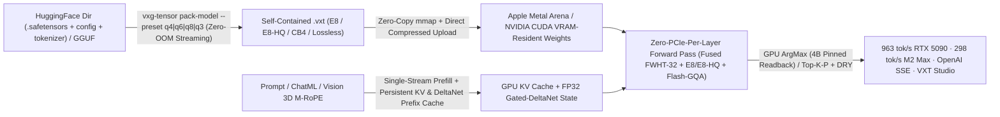

# `vxg-tensor` (`.vxt`) — Compressed-Domain AI Codec (`VXT-Turbo E8/E8-HQ`), Apple Metal & NVIDIA CUDA Resident LLM/VLM/MoE Engine & `VXT Studio`

`crates/vxg-tensor` extends VXG into **neural network weight compression (`.vxt` `VXT1`), zero-decompression Apple Metal & NVIDIA CUDA GPU LLM/VLM/MoE inference, production OpenAI-compatible SSE serving with Prometheus metrics, and the `VXT Studio` desktop application (`apps/vxt-studio`)**.

Instead of inflating compressed weights back to `BF16`/`FP16` in RAM or VRAM, `vxg-tensor` uploads the **compressed `.vxt` planes directly into Apple Silicon Unified Memory or NVIDIA GPU VRAM** and executes the entire autoregressive forward pass (`RMSNorm`, `Gated-DeltaNet`, `Flash-Decoding` `Gated-GQA`, `SwiGLU`/`GeGLU`, `MoE` Top-K routing, and `248,320`-vocab `LM Head` + GPU argmax) directly from compressed representations with **zero per-layer host syncs**.

<TensorBenchmarkChart />

---

## Production Highlights (Apple M2 Max Metal & NVIDIA RTX 5090 CUDA)

- **`VXT-Turbo-HQ` (`E8-HQ`, `bits = 8`) Beats `GGUF Q6_K` and `GGUF Q8_0` at Smaller Sizes (`Qwen3.5-9B`, 22-Model Eval — [`reports/qwen35-9b-compression-eval.json`](../reports/qwen35-9b-compression-eval.json))**:
  - **`--preset q8` (`7.713 bpw`, `8.632 GB`)**: **`0.89 GB` smaller** than `GGUF Q8_0` (`8.503 bpw`, `9.517 GB`), beats `Q8_0` on Wiki 580ch PPL (`8.1826` vs `8.1951`), Wiki Med KLD (`0.0004` vs `0.0005`), and TR Mean KLD (`0.0004` vs `0.0009`, **`-55.6%`**), while tying TR Top-1 (`98.80%`).
  - **`--preset q6` (`6.269 bpw`, `7.017 GB`)**: **`0.43 GB` smaller** than `GGUF Q6_K` (`6.654 bpw`, `7.447 GB`), beats `Q6_K` on Wiki 580ch PPL (`8.1883` vs `8.2195`), Wiki Med KLD (`0.0011` vs `0.0014`), Wiki Top-1 (`97.55%` vs `97.45%`), TR Mean KLD (`0.0015` vs `0.0022`, **`-31.8%`**), and TR Top-1 (`98.31%` vs `97.75%`).
  - **`--preset q4` (`~4.50 bpw`)** & **`--preset q3` (`VXT-Turbo v5`, `E8`, `bits = 7`, `~3.05 bpw`)**: Dominate the sub-5 bpw Pareto frontier (`~0.9 bpw` smaller than `GGUF Q4_K_M`, `5.2x` smaller than `BF16`).
- **Native 100% VRAM-Resident NVIDIA CUDA Runner (`VXT-Turbo Resident`, `native/cuda/vxt_cuda_llm.cu`)**:
  - Verified live on **NVIDIA GeForce RTX 5090 (`sm_120`, CUDA 12.8.93)** with zero per-layer PCIe transfers, fused sibling multi-GEMV, split-K residual projections, register-cached `Gated-DeltaNet`, online-softmax FlashDecoding `Gated-GQA`, and 4-byte pinned GPU argmax readback:
    - **`Qwen3.5-0.8B --preset q3` (`E8`, `323.02 MiB`)**: **`962.86 tok/s`** decode (**`1,186.2 tok/s`** prefill; **`55.5×`** faster than per-matrix CUDA, **`364.7×`** faster than 16-thread CPU), **100% token-for-token identical** to CPU across 94 generated tokens.
    - **`Qwen3.5-0.8B --preset q6` (`E8-HQ`, `611.41 MiB`)**: **`738.63 tok/s`** CLI / **`796.28 tok/s`** OpenAI `serve` JSON mode (**`1,006–1,018 tok/s`** prefill, `473.5 GB/s` compressed stream), **`593.75 tok/s`** with `--temp 0.6` 248K-vocab sampling.
    - Hybrid 4-stage unit-test parity (`0-layer embed`, `1-layer DeltaNet`, `1-layer Gated-GQA`, `2-layer Hybrid`): **`max_err = 2e-6 – 4e-6`**.
- **Apple Metal Pipelined Runners (`VXT-Turbo Pipelined` & `CB4-Fast`)**:
  - **`VXT-Turbo Pipelined`**: `297.94 tok/s` on `Qwen3.5-0.8B` (Apple M2 Max) with zero-LUT warp-shuffle `FWHT-32` + `E8`/`E8-HQ` decode and 2-deep pipelined `MTLCommandBuffer` bursts.
  - **`Qwen3.5-9B` + Native Multimodal Vision (`VLM`, `4.82 GiB`, `47.15 tok/s`, `244.3 GB/s` compressed stream)**: Full `Qwen3_5VisionModel` ViT + `2×2` `PatchMerger` + exact Metal **3D `M-RoPE` (`mrope_section = [11, 11, 10]`)** + multi-turn ViT/KV/DeltaNet prefix caching.
  - **`Qwen3.5-2B` `CB4-v2` + `CB4-Fast` (`988.42 MiB`, `175.92 tok/s`, `36/40` `BF16` parity)**: Zero-shot analytical super-weight calibration (`0.047588 nats` KL, `0.972549` cosine similarity).
- **Zero-OOM Streaming `.vxt` Disk Writer & `3.13×` Faster Packing**:
  - `VxtStreamWriter` (`format_stream.rs`, `llm_pack_stream.rs`) flushes each calibrated layer batch directly to disk so `27B`/`70B+` models pack in bounded RAM (`~4–8 GB` peak RSS).
  - Hoisted thread pools, L1 `Block32Chol`, lock-free `sgemm_nt_k32_4x4`, and parallel archive encoding cut `Qwen3.5-9B` packing from **`30m58s -> 9m53s` (`3.13×`)** on Linux and `Qwen3.5-0.8B` from **`52.8s -> 21.7s`** (`turbo-hq`) on M2 Max.
- **Mixture-of-Experts (`MoE`) & Production OpenAI Serving**:
  - Full `MoE` routing (`llm_moe.rs`) supporting `Qwen3-MoE`, `Mixtral`, and `DeepSeek-MoE` (Top-K softmax router, per-expert SwiGLU/GeGLU, optional gated shared expert `shexp`).
  - OpenAI-compatible HTTP/SSE server (`vxg-tensor serve`): `/v1/chat/completions` (SSE streaming, `tools`/`tool_calls`, `response_format` `json_object`/`json_schema`, `stop` sequences, Vision `image_url`), `/v1/completions`, `/v1/models`, `/health`, and **Prometheus `/metrics`**.
  - Standalone **`VXT Studio`** desktop app (`apps/vxt-studio`, `Tauri v2` + `React 19` + `shadcn/ui` + Vercel AI SDK) with HuggingFace Hub direct download + streaming preset packing, multimodal Vision Chat, JSON mode/stop controls, and live `/metrics` API Hub.

---

## Architecture: Compressed-Domain GPU Pipelines (Metal & CUDA)



---

## 1. `Qwen3.5-9B` Quality & Size vs. `GGUF` (`reports/qwen35-9b-compression-eval.json`)

Evaluated across `22` archives on the exact same `Qwen/Qwen3.5-9B` base weights (WikiText-2 `580`-char PPL, Wiki Median KLD, Wiki Top-1, Turkish Mean KLD, and Turkish Top-1):

| Format / Preset | `bpw` | Size (`GB`) | Wiki 580ch PPL ↓ | Wiki Med KLD ↓ | Wiki Top-1 ↑ | TR Mean KLD ↓ | TR Top-1 ↑ |
| :--- | :---: | :---: | :---: | :---: | :---: | :---: | :---: |
| **`VXT-Turbo-HQ (Q8, s=0.25)`** | **`7.713`** | **`8.632`** | **`8.1826`** | **`0.0004`** | `98.18%` | **`0.0004`** | **`98.80%`** |
| `GGUF Q8_0` *(reference)* | `8.503` | `9.517` | `8.1951` | `0.0005` | `98.27%` | `0.0009` | `98.80%` |
| **`VXT-Turbo-HQ (Q6, s=0.75)`** | **`6.269`** | **`7.017`** | **`8.1883`** | **`0.0011`** | **`97.55%`** | **`0.0015`** | **`98.31%`** |
| `GGUF Q6_K` *(reference)* | `6.654` | `7.447` | `8.2195` | `0.0014` | `97.45%` | `0.0022` | `97.75%` |

---

## 2. Live NVIDIA RTX 5090 CUDA Resident Speed (`Qwen3.5-0.8B`, `sm_120`, CUDA 12.8)

| Preset / Path | Archive Size | Prefill (`tok/s`) | Decode (`tok/s`) | Speedup vs Per-Matrix CUDA (`17.5 tok/s`) | Speedup vs 16T CPU (`2.65 tok/s`) |
| :--- | :---: | :---: | :---: | :---: | :---: |
| **`--preset q3` (`E8`, `bits=7`) — `run`** | `323.02 MiB` | **`1,186.2`** | **`962.86`** | **`55.5×`** | **`364.7×`** |
| **`--preset q6` (`E8-HQ`, `bits=8`) — `run`** | `611.41 MiB` | **`1,006.0`** | **`738.63`** | **`41.8×`** | **`277.7×`** |
| **`--preset q6` (`E8-HQ`) — `serve` JSON API** | `611.41 MiB` | **`1,018.2`** | **`796.28`** | **`45.1×`** | **`299.4×`** |
| **`--preset q6` (`--temp 0.6` 248K sampling)** | `611.41 MiB` | **`999.5`** | **`593.75`** | **`33.6×`** | **`223.2×`** |

---

## 3. Apple M2 Max Metal Benchmarks (`Qwen3.5-2B` & `Qwen3.5-9B`)

| Model & Mode (`.vxt` / Reference) | Archive Size | Ratio vs `BF16` | `4×16` Split `KL` (nats) | 40-Item Strict Gen | Prefill (`tok/s`) | Decode (`tok/s`) |
| :--- | :---: | :---: | :---: | :---: | :---: | :---: |
| `Qwen3.5-2B` Raw `BF16` Ref (`.gguf` / HF) | `3600.8 / 4337.5 MiB` | `1.00×` | `0.000000` | **`36 / 40`** | `40.2` | `38.4` |
| `Qwen3.5-2B` **`VXT-Lossless-BF16`** | **`2556.80 MiB`** | `1.41× / 1.70×` | **`0.000000`** | **`36 / 40`** | `41.6` | `49.6` |
| `Qwen3.5-2B` **`VXT-CB4-v2` (`CB4-Fast`)** | **`988.42 MiB`** | `3.64× / 4.39×` | **`0.047588`** | **`36 / 40`** | **`221.9`** | **`175.9`** |
| `Qwen3.5-9B` **`VXT-CB4-v2` + Vision VLM** | **`4940.12 MiB`** | `3.73×` | — | Vision 3D M-RoPE | — | **`47.2`** |
| `Qwen3.5-0.8B` **`VXT-Turbo-HQ` (`Metal`)** | `~611 MiB` | `2.66×` | — | Exact E8-HQ | — | **`297.9`** |

---

## Mathematical Codec Modes (`VXT1`)

Every `.vxt` archive (`MAGIC = b"VXT1"`, version `1`) embeds `model.config`, Byte-Level BPE tables (`tokenizer.tokens`, `tokenizer.merges`, `tokenizer.types`), optional `vision.config`, and `64`-byte-aligned compressed tensors with `64`-bit FNV-1a integrity verification:

1. **`VXT-Turbo` (`E8`, `bits = 7`) & `VXT-Turbo-HQ` (`E8-HQ`, `bits = 8`) (`KIND_TURBO_WHT = 5`)**:
   - Deterministic `±1` column sign flips + blockwise $32 \times 32$ **Fast Walsh-Hadamard Transform** ($W_{\text{rot}} = W H_{32}$, executed via register-only warp-shuffle butterflies on Metal & CUDA).
   - 8D Gosset Lattice (`E8` 4-bit / `E8-HQ` 8-bit even-parity coset) quantization solved under full-width `SuperBlockHessian` `act_order` `LDL-GPTQ` with Schur-complement Lagrangian water-filling (`Lagr(alpha)`), zero lookup tables on GPU, and exact `f16` 32-column sub-scales.
2. **`VXT-Lossless-BF16` / `FP16` (`KIND_LOSSLESS = 1`)**: Sign + mantissa bit-planes + per-tensor Top-7 Exponent LUT (`11.35 bpw` on `Qwen3.5-2B`, `100%` bit-exact).
3. **`VXT-CB4-v2` & `VXT-CB3` (`KIND_CODEBOOK = 2`)**: Analytical channel-amplitude (`col_amp`) + sparse `FP16` CSR outliers + alternating weighted Lloyd-Max cubic centroids.

---

## CLI, OpenAI Server & `VXT Studio` Quick Reference

```sh
# Build on macOS (Apple Metal GPU + Accelerate AMX automatically enabled)
cargo build --release -p vxg-tensor --bin vxg-tensor

# Build on Linux with NVIDIA CUDA Resident GPU + OpenBLAS
VXG_CUDA=1 VXG_OPENBLAS=1 VXG_CUDA_ARCH=native \
  cargo build --release -p vxg-tensor --bin vxg-tensor

# 1. Zero-OOM streaming pack from HuggingFace dir or GGUF using Pareto presets (q3|q4|q6|q8|lossless)
./target/release/vxg-tensor pack-model ./Qwen3.5-9B Qwen3.5-9B-q6.vxt --preset q6 --threads 16
./target/release/vxg-tensor pack-model Qwen3.5-9B-BF16.gguf Qwen3.5-9B-q4.vxt --preset q4 --threads 16

# 2. Run directly on Metal or NVIDIA CUDA Resident GPU (zero PCIe per layer)
./target/release/vxg-tensor run Qwen3.5-9B-q6.vxt --temp 0 -n 256 \
  -p "Explain why memory bandwidth limits LLM inference in 3 bullet points."

# 2b. Multimodal Vision (path, file://, or data:image/... URI)
./target/release/vxg-tensor run Qwen3.5-9B-cb4-v2.vxt \
  --image screenshot.png --temp 0 -n 256 -p "Bu görseldeki diyagramı açıkla."

# 3. Interactive multi-turn terminal chat (stateful KV + DeltaNet prefix cache)
./target/release/vxg-tensor chat Qwen3.5-9B-q6.vxt

# 4. Production OpenAI-compatible server (/v1/chat/completions, /v1/completions, tools, JSON mode, /metrics)
./target/release/vxg-tensor serve Qwen3.5-9B-q6.vxt --port 11435
curl -s http://127.0.0.1:11435/metrics

# 5. Launch or bundle the standalone VXT Studio desktop app (Tauri v2 + React 19)
cd apps/vxt-studio && pnpm install && pnpm tauri dev     # or: pnpm tauri build
```
