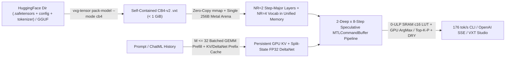

# `vxg-tensor` (`.vxt`) — Compressed-Domain AI Model Codec, `CB4-Fast` Apple Metal LLM Engine & `VXT Studio`

`crates/vxg-tensor` extends VXG from structured telemetry and columnar analytics into **neural network weight compression (`.vxt` `VXT1`), zero-decompression Apple Metal GPU / SIMD LLM inference, OpenAI-compatible SSE serving, and the `VXT Studio` desktop application (`apps/vxt-studio`)**.

Instead of inflating compressed weights back to `BF16`/`FP16` in RAM or VRAM, `vxg-tensor` uploads the **compressed `.vxt` planes directly into Apple Silicon Unified Memory** and executes the entire autoregressive LLM forward pass (`RMSNorm`, `Gated-DeltaNet` recurrent state updates, `Flash-Decoding` `Gated-GQA`, `SwiGLU`, and `248,320`-vocab `LM Head`) directly from compressed representations on GPU.

<TensorBenchmarkChart />

---

## Key Highlights (`Qwen3.5-2B` End-to-End on Apple M2 Max)

- **`CB4-v2` + `CB4-Fast` All-GPU Engine (`988.42 MiB`, `~176 tok/s`, `BF16` Quality Parity)**:
  - Shrinks `Qwen3.5-2B` from **`3600.80 MiB` (`.gguf` `BF16`) / `4337.52 MiB` (official HuggingFace `.safetensors`) -> `988.42 MiB` (`4.38 bpw`, `3.64x–4.39x` smaller)** — `32.4 MiB` smaller than `GGUF Q4_0` (`1020.83 MiB`).
  - **Zero-Shot Analytical Super-Weight Calibration (`CB4-v2`)**: Propagates residual-writer channel RMS (`ffn_down`, `ssm_out`, `attn_output`), `RMSNorm` gains, and 2-hop `SwiGLU` / `DeltaNet` / `GQA` row sensitivities (`col_amp`) without touching any calibration prompts, reaching **`36/40` (`0.900`) strict 40-item free-generation parity with raw `BF16` (`36/40`)**, **`0.047588 nats` `4x16` split KL divergence (`-16.6%` vs `CB4-v1`)**, **`0.972549` logit cosine similarity**, and **`61/64` Top-1 agreement** ([`reports/cb4-v2-2026-11-08.md`](../reports/cb4-v2-2026-11-08.md)).
  - **`MetalCb4FastRunner` (`0-ULP` Exact, `175.92 tok/s`)**: Packs all model layers (`NR = 2` step-major) and `248,320`-row vocabulary (`NR = 4` tile-major) into a single `256B`-aligned Metal arena with `32`-bit SRAM `c16` codebook LUTs, `64`-threadgroup split-state `FP32` `DeltaNet`, batched `M <= 32` prefill (`221.9 tok/s`), and `2`-deep `8`-step speculative command-buffer pipelining (`182.3 GB/s` effective compressed weight bandwidth).
- **100% Bit-Exact Lossless (`VXT-Lossless-BF16`)**: Shrinks `Qwen3.5-2B` to **`2556.80 MiB` (`1.41x` smaller, `11.35 bpw`)** with **`0.000000 nats` KL divergence**, `1.000000` cosine similarity, and `100.0%` bit-for-bit weight identity at **`49.6 tok/s`** directly on compressed bit-planes.
- **Ultra-Compact Sub-800 MiB & Sub-670 MiB Modes (`CB3`, `WHT2`, `VXT-Turbo`)**:
  - `VXT-CB3+Outlier` (`3.38 bpw`): **`772.40 MiB` (`4.66x` smaller)** with **`0.1117 nats` KL** and **`80.4 tok/s`** GPU decode.
  - `VXT-WHT2+Outlier` (`2.31 bpw` Walsh-Hadamard 2-bit FFN/Attn + `3.38 bpw` recurrent gates): **`645.96 MiB` (`5.57x` smaller)** at **`114.2 tok/s`** GPU decode (`140.9 tok/s` prefill).
- **Direct HuggingFace Folder & `.gguf` Packing**: Converts raw HuggingFace model directories (`config.json` + `tokenizer.json` + single or sharded `model.safetensors.index.json`) or `.gguf` files directly into self-contained `.vxt` models without external Python/`llama.cpp` toolchains.
- **Multi-Turn Stateful Chat, OpenAI SSE Server & `VXT Studio`**:
  - Prefix-cached `KV + Recurrent Gated-DeltaNet` multi-turn `ChatSession` (`152+ tok/s` cached follow-up turns), official Qwen BPE pretokenizer (`NFC` + Unicode regex), `top-k/top-p` sampling, and exponential **DRY** suffix-clone anti-loop protection for long `--think` reasoning chains.
  - Built-in OpenAI-compatible HTTP/SSE server (`vxg-tensor serve`, `/v1/models`, `/v1/chat/completions`) and standalone **`VXT Studio.app` / `.dmg`** desktop suite (`Tauri v2` + `React 19` + `shadcn/ui` + Vercel AI SDK).

---

## Architecture & `CB4-Fast` Speculative Metal Pipeline



### Why Single-Arena + 2-Deep Pipelined `MTLCommandBuffer` Matters on Apple Silicon

Launching individual `GEMV` command buffers per projection (`97+` commits/token) incurs ~`450 us` of XNU/Metal scheduler overhead per token, capping throughput near `15 tok/s`.

`vxg-tensor` eliminates both CPU-GPU sync stalls and L1/SLC gather bottlenecks across two tiers:
1. **`MetalCb4FastRunner` (`src/metal_cb4_fast.rs`, `native/metal_cb4_fast*.mm`, `native/shaders/vxt_cb4_fast*.metal`)**:
   - **Single Contiguous Weight Arena**: Concatenates shared-input projections (`[wqkv; attn_gate]`, `[wq; wk; wv]`, `[ffn_gate; ffn_up]`) in `NR = 2` step-major layout (`256`-column coalesced SIMD transactions) and `token_embd` / `lm_head` in `NR = 4` tile-major layout.
   - **Zero-ULP 32-Bit SRAM `c16` Codebook LUT**: Precomputes the exact cubic polynomial centroids once into `threadgroup` SRAM (`0-ULP` bit-identical to register polynomial `fma()`), eliminating inner-loop polynomial math.
   - **`64`-TG Split-State `FP32` `DeltaNet` & `M = 1` Flash-GQA**: Partitions recurrent `128 x 128` head state updates across `64` threadgroups (`16` heads $\times 4$ `dv` splits) to saturate all Apple Silicon GPU cores even at batch size `1`.
   - **`2`-Deep Speculative `8`-Step Burst Execution**: Enqueues `8` autoregressive steps per `MTLCommandBuffer` with GPU-side argmax token chaining and `FP32` `DeltaNet` state checkpoints, rolling back cleanly on mid-burst EOS (`<|im_end|>`) so multi-turn prefix caches remain exact.
2. **Universal `MetalLlmRunner` (`src/metal_llm.rs`, `native/metal_llm.mm`)**: Executes `Lossless`, `CB3`, `WHT2`, and `Q4_0` `.vxt` models inside a single concurrent `MTLCommandBuffer` (`MTLDispatchTypeConcurrent` + `MTLBarrierScopeBuffers`).

---

## Mathematical Codec Modes (`VXT1`)

Every `.vxt` archive (`MAGIC = b"VXT1"`, version `1`) embeds `model.config`, Byte-Level BPE tables (`tokenizer.tokens`, `tokenizer.merges`, `tokenizer.types`), and `64`-byte-aligned compressed tensors with `64`-bit FNV-1a integrity verification:

1. **`VXT-Lossless-BF16` / `FP16` (`KIND_LOSSLESS = 1`)**: Sign + mantissa bit-planes + per-tensor **Top-7 Exponent LUT (`3`-bit index + escape stream)** in `256`-element superblocks (`11.35 bpw` on `Qwen3.5-2B`, `100%` bit-exact).
2. **`VXT-CB4-v2` & `VXT-CB3` (`KIND_CODEBOOK = 2`)**:
   - **Analytical Channel-Amplitude (`col_amp`) & Role-Aware Sparse `FP16` CSR Outliers**: Protects attention-sink / super-weight channels (e.g., `ch 1201` at `3.38x` RMS) and sensitive projections (`attn_k/v`, `attn_output`, `ssm_out`, `ffn_down`) in a compact `(col_u16, val_fp16)` CSR stream (`~0.5%–1.3%` density).
   - **Alternating Weighted Lloyd-Max + `FP16`-Quantized Scale Optimization (`cb4_opt.rs`)**: Jointly optimizes group scales (snapped to exact `FP16`) and degree-3 polynomial centroids $c(u) = a_0 + u(a_1 + u(a_2 + u a_3))$.
3. **`VXT-WHT2` & `VXT-Turbo` (`KIND_WHT2 = 4`, `KIND_TURBO_WHT = 5`)**: Applies an orthogonal $32 \times 32$ **Fast Walsh-Hadamard Transform** ($W_{\text{rot}} = W_{\text{bulk}} H_{32}$, $H_{32}^T H_{32} = I_{32}$) via register-only `simd_shuffle_xor` butterflies before low-bit (`2–4 bpw`) codebook / Huffman quantization.

---

## Real-Model Benchmarks (`Qwen3.5-2B`, Apple M2 Max)

### 1. End-to-End LLM Compression, Quality & Apple Metal Speed

| Mode (`.vxt` / Reference) | Archive Size | Ratio vs `BF16` (`.gguf` / HF) | `4x16` Split `KL` (nats) | `4x16` `CosSim` | 40-Item Strict Gen | Prefill (`tok/s`) | Decode (`tok/s`) |
| :--- | :---: | :---: | :---: | :---: | :---: | :---: | :---: |
| **Raw `BF16` Ref (`.gguf` / HF)** | `3600.8 / 4337.5 MiB` | `1.00x` | `0.000000` | `1.000000` | **`36 / 40` (`0.900`)** | `40.2` | `38.4` |
| **`VXT-Lossless-BF16`** | **`2556.80 MiB`** | **`1.41x / 1.70x`** | **`0.000000`** | **`1.000000`** | **`36 / 40` (`0.900`)** | `41.6` | `49.6` |
| **`GGUF-Q4_0` (`.vxt` ref)** | `1020.83 MiB` | `3.53x / 4.25x` | `0.053324`* | `0.954276`* | — | `160.0` | `137.3` |
| **`VXT-CB4` (`v1` baseline)** | `988.60 MiB` | `3.64x / 4.39x` | `0.057072` | `0.964729` | `32 / 40` (`0.800`) | `133.0` | `105.0` (`173.2` fast) |
| **`VXT-CB4-v2` (`CB4-Fast`)** | **`988.42 MiB`** | **`3.64x / 4.39x`** | **`0.047588`** | **`0.972549`** | **`36 / 40` (`0.900`)** | **`221.9`** | **`175.9`** |
| **`VXT-CB3+Outlier`** | **`772.40 MiB`** | **`4.66x / 5.62x`** | `0.111692`* | `0.863824`* | — | `118.2` | `80.4` |
| **`VXT-WHT2+Outlier` (Hybrid)** | **`645.96 MiB`** | **`5.57x / 6.71x`** | `0.799811`* | `0.646364`* | — | `140.9` | `114.2` |

*\*16-step single-prompt teacher rollout (`vxg-tensor eval`); `CB4-v1` and `CB4-v2` report the stricter 4-category `4x16 = 64`-step independent split ([`reports/cb4-v2-2026-11-08.md`](../reports/cb4-v2-2026-11-08.md)).*

### 2. Single-Matrix Fused Metal GPU `GEMV` (`token_embd.weight`, `248,320 x 2048`)

| Kernel | Compressed Size | `bpw` | Ratio | Weight `SQNR` | `GEMV` `CosSim` | GPU Latency | Effective `BF16` BW | Speedup vs Raw `BF16` |
| :--- | :---: | :---: | :---: | :---: | :---: | :---: | :---: | :---: |
| **Raw `BF16` Baseline** | `970.00 MiB` | `16.00` | `1.00x` | Bit-Exact | `1.000000` | `2908.5 us` | `349.7 GB/s` | `1.00x` |
| **`VXT-Lossless-BF16`** | `688.19 MiB` | `11.35` | `1.41x` | **Bit-Exact** | **`1.000000`** | `3768.6 us` | `269.9 GB/s` | `0.77x` |
| **`GGUF-Q4_0-Ref`** | `272.81 MiB` | `4.50` | `3.56x` | `19.69 dB` | `0.993411` | `1021.4 us` | `995.8 GB/s` | `2.85x` |
| **`VXT-CB4+Outlier`** | **`266.74 MiB`** | **`4.40`** | **`3.64x`** | **`20.68 dB`** | **`0.994593`** | `1431.6 us` | **`710.5 GB/s`** | **`2.03x`** |
| **`VXT-CB3+Outlier`** | **`205.27 MiB`** | **`3.39`** | **`4.73x`** | **`15.40 dB`** | **`0.981885`** | `1747.1 us` | **`582.2 GB/s`** | **`1.66x`** |
| **`VXT-WHT2+Outlier`** | **`143.68 MiB`** | **`2.37`** | **`6.75x`** | `9.74 dB` | `0.932103` | `1412.6 us` | **`720.0 GB/s`** | **`2.06x`** |

---

## CLI, OpenAI Server & `VXT Studio` Quick Reference

```sh
# Build the tensor codec + Apple Metal GPU engine
cargo build --release -p vxg-tensor --bin vxg-tensor

# 1a. Pack a HuggingFace model folder (config.json + tokenizer.json + single/sharded .safetensors) -> CB4-v2 .vxt
./target/release/vxg-tensor pack-model ./Qwen3.5-2B qwen35_2b_cb4_v2.vxt --mode cb4

# 1b. Or pack a GGUF LLM into a self-contained CB4-v2 .vxt archive
./target/release/vxg-tensor pack-model Qwen3.5-2B-BF16.gguf qwen35_2b_cb4_v2.vxt --mode cb4

# 2. Single-turn generation (176 tok/s greedy with --cb4-greedy, or sampled --think reasoning)
./target/release/vxg-tensor run qwen35_2b_cb4_v2.vxt \
  --cb4-greedy --temp 0 --presence-penalty 0 -n 256 \
  -p "Explain why memory bandwidth limits LLM inference in 3 bullet points."

# 3. Interactive multi-turn terminal chat (stateful KV + DeltaNet prefix cache, /think, /fast, /reset)
./target/release/vxg-tensor chat qwen35_2b_cb4_v2.vxt

# 4. Launch the OpenAI-compatible SSE server (http://127.0.0.1:11435/v1/chat/completions)
./target/release/vxg-tensor serve qwen35_2b_cb4_v2.vxt --port 11435

# 5. Build the standalone macOS VXT Studio desktop app (.app + .dmg)
cd apps/vxt-studio && pnpm install && pnpm tauri build
```

### Native Lossless Contract (`pack-native` / `verify-native`)

For strict bit-exact archival of the `Qwen3.5-2B` language trunk retaining original HuggingFace tensor names, shapes, and raw `config.json` / `tokenizer.json` payloads:

```sh
vxg-tensor pack-native model.safetensors config.json tokenizer.json qwen35-native.vxt
vxg-tensor verify-native model.safetensors config.json tokenizer.json qwen35-native.vxt
vxg-tensor run qwen35-native.vxt --prompt "Hello" --raw --max-tokens 8
```
