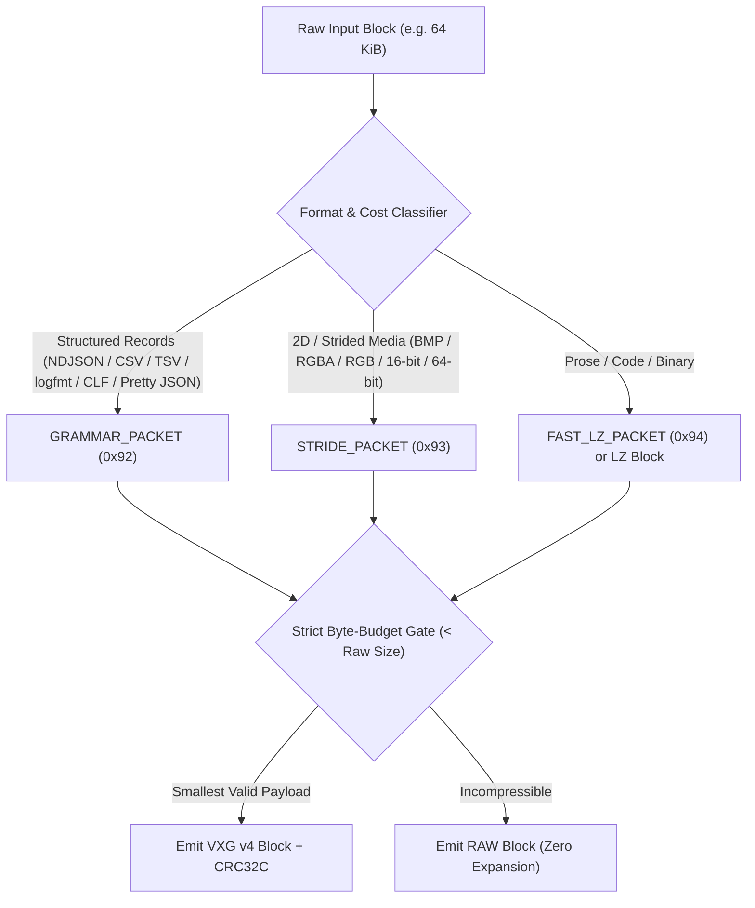

# Architecture & SIMD Internals

VXG is built around a simple principle: **modern data is rarely an unstructured byte soup**, yet general-purpose compressors treat every input as a flat 1D byte stream. At the same time, a production codec must **never regress** on unstructured prose, source code, or binary blobs.

---

## 1. Block-Independent Multi-Packet Pipeline

Every VXG frame partitions the input into fixed-size independent blocks (`64 KiB` default, configurable from `4 KiB` to `1 MiB` in multiples of `64` bytes). Each block is encoded and decoded **without any cross-block state**, enabling:
- **Linear multi-core scaling** via lock-free `AtomicUsize` work-stealing across blocks
- **$O(1)$ random-access block extraction** using the compact 8-byte v4 directory
- **Bounded working set** (each thread reuses a thread-local scratch arena)

---

## 2. The Four Packet Engines in `BLOCK_COLUMN`

### 2.1 `GRAMMAR_PACKET` (`0x92`) — Vectorized Execution Grammar

When a block contains newline-delimited records (JSON objects, CSV/TSV rows, `key=value` logfmt lines, bracketed Apache/Nginx CLF logs, or multi-line pretty-printed JSON objects):

1. **SIMD Structural Tokenization:**
   - Uses 64-byte bitmask scanners (`delimited_masks64` and `json_quote_mask64` via ARM64 `NEON` `vpaddq_u8` or `x86_64` `AVX2` `_mm256_movemask_epi8` / `SSE2`) to locate quotes, escapes, and delimiters in parallel.
2. **Template & Slot Extraction (`≤ 64` templates, `≤ 64` slots):**
   - Separates invariant structural literals (`{"ts":"`, `","level":"`, `","latency":`, `}\n`) from variable column slots.
   - Handles schema drift and optional fields via multi-template dictionary indexing, and seamlessly falls back to chunked sub-records when rows exceed 64 columns.
3. **10 Specialized Column Models:**
   - `MODEL_CONST` (`0`): Constant column across all rows of a template
   - `MODEL_DICT` (`1`): Dictionary + bit-packed or sparse-mode indices (`1..=16` bits)
   - `MODEL_INT_DELTA` (`2`): ZigZag / affine / frame-of-reference integer progressions
   - `MODEL_TIMESTAMP` (`3`): Branchless 64-bit SWAR ISO-8601 timestamp parser & bit-packer
   - `MODEL_HEX_SUFFIX` (`4`): SIMD hex-nibble packer (`vqtbl1q_u8` / `_mm_shuffle_epi8`)
   - `MODEL_PERIODIC_STRING` (`5`): Cyclic string period detector (`1..=64`)
   - `MODEL_EPOCH_COUNTER_ID` (`6`): Composite `prefix-epoch-counter-suffix` decomposer
   - `MODEL_SEGMENT_DICT` (`7`): Semi-colon/phrase dictionary + `DEC_10K` lookup table
   - `MODEL_DECIMAL_DELTA` (`8`): Fixed-point decimal (`1..=3` fractional digits) delta coder
   - `MODEL_FRONT_DICT` (`9`): Front/back-coded (`LCP` + `LCS` + 4-bit/5-bit SIMD nibble palette) string dictionary
4. **Fused Single-Pass Replay (`BoundStream` & `FastPiece`):**
   - During decode, all columns are unpacked into a contiguous thread-local arena (`DecodeScratch`), and rows are reconstructed via branchless 16-byte SIMD unaligned vector copies (`vst1q_u8` on `aarch64`, `_mm_storeu_si128` on `x86_64`).

### 2.2 `STRIDE_PACKET` (`0x93`) — Strided Decorrelation + SubGreen

For 2D images, framebuffers, and fixed-stride binary arrays (`stride ∈ {2, 3, 4, 8}`):
- Applies optional **SubGreen** color decorrelation (`R' = R - G`, `B' = B - G`) and per-plane horizontal delta coding.
- Uses a **48-byte / 64-byte SIMD constant-run fast skip** during encoding and reconstructs identical pixel runs in **16-pixel / 64-byte SIMD chunks** (`vst4q_u8` / `vst3q_u8` on `aarch64`, `_mm_shuffle_epi8` + `_mm_unpacklo_epi8` on `x86_64`).

### 2.3 `FAST_LZ_PACKET` (`0x94`) — 4-Stream Canonical Huffman + Fast-LZ

For prose, source code, and general binary data:
- Parses literals, match lengths, and 16-bit offsets using a dual-slot hash table with lazy match evaluation.
- Applies **4-stream interleaved canonical Huffman coding** (`<= 11-bit` codes) independently to literal bytes, token bytes, match-extension bytes, and offset high/low bytes when entropy coding reduces payload size.
- Decodes via a single-table `2048`-entry (`u16` symbol + bit-length) lookup loop reading 4 bitstreams in parallel to saturate CPU instruction-level parallelism.

---

## 3. Cross-Architecture SIMD Parity (`aarch64` & `x86_64`)

Every hot path in VXG has matched vector implementations for both **ARM64 (`NEON`)** and **x86_64 (`SSE2` / `SSSE3` / `SSE4.1` / `AVX2` / `AVX-512`)**:

| Subsystem | `aarch64` (`NEON`) | `x86_64` (`SSE2` / `SSSE3` / `SSE4.1` / `AVX2`) |
| :--- | :--- | :--- |
| **16-Byte Grammar & LZ Copies** | `vld1q_u8` / `vst1q_u8` (`u128` hardware registers) | `_mm_loadu_si128` / `_mm_storeu_si128` (zero GPR pressure) |
| **JSON / Delimiter Structural Masks** | `vceqq_u8` + `vpaddq_u8` pairwise bit-pack | `AVX2` `_mm256_cmpeq_epi8` + `_mm256_movemask_epi8` |
| **RGB (`stride=3`) Deinterleave / Interleave** | `vld3q_u8` / `vst3q_u8` + 48B constant skip | `SSSE3` `_mm_shuffle_epi8` (`pshufb`) + 48B constant skip |
| **RGBA (`stride=4`) Prefix Sum & Interleave** | `vextq_u8` Hillis-Steele scan + `vst4q_u8` | `_mm_slli_si128` Hillis-Steele scan + `_mm_unpacklo/hi_epi8/16` |
| **4/5/6-Bit Palette & Front-Dict Unpack** | `vqtbl1q_u8` / `vqtbl2q_u8` / `vqtbl4q_u8` | `SSSE3`/`SSE4.1` `_mm_shuffle_epi8` + `_mm_blendv_epi8` |
| **CRC32C Checksum** | Hardware ` __crc32cd` (`crc` target feature) | Hardware `_mm_crc32_u64` (`sse4.2` target feature) |
